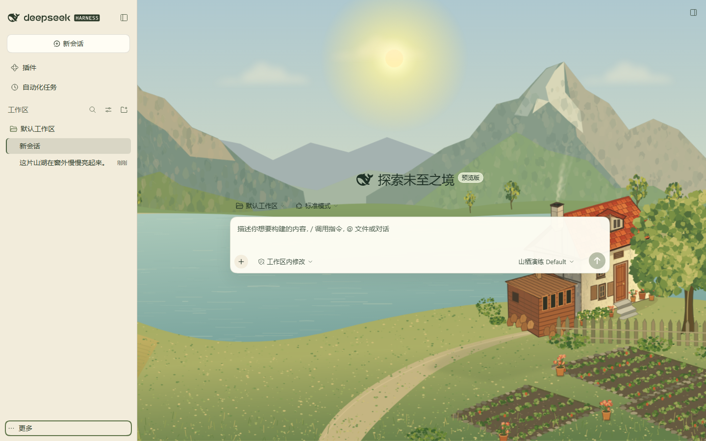

# 山栖 · dsh-shanqi-theme

一套可安装的 DeepSeek Harness 田园主题插件：把真实的欢迎页、聊天、侧栏、设置页与公共控件接入一幅手绘山湖；场景按本机系统时间连续呈现晨光、白昼、黄昏与夜晚；田间农人由当前展示对话的**任务工作状态（`SessionSnapshot.running`）**驱动进出场。

- npm 包名：`dsh-shanqi-theme`
- 配置入口：`ui-shanqi-theme`
- 显示名称：山栖
- 目标版本：**DSH 0.2.1-rc.2**（Web 与 Windows Desktop）
- 独立场景预览：[docs/preview.html](docs/preview.html)



## 功能

- **真实界面接入**：场景只在宿主真实的 `main.conversation` 区域后方绘制，不嵌入演示 HTML，不重建聊天或设置业务，不覆盖模型调用、流式输出、工具调用、账号与权限。
- **昼夜连续**：默认跟随本机系统时间，由 `Date` 直接计算，不累计计时；休眠、后台、长时间运行不会漂移。页面恢复可见、窗口重新获得焦点时立即同步。
- **浅色与深色**：同时提供两套宿主令牌，不强制切换 DSH 外观，不写用户主题偏好，不产生 `theme/change` 递归。场景入夜时侧栏、设置弹窗、菜单、输入卡、present 卡片与 diff 行一起沉色。
- **任务联动**：农人默认不出现。当前展示对话有任务在工作时（从发出消息开始，模型思考、工具调用、回答流式输出都算同一轮任务）扛锄进场、停步耕作；整轮任务结束、取消或报错时收锄、上肩、沿小径离开。连接中断、切换对话也会收起或清理联动。
- **透明回答**：用户消息是靠右气泡；助手回答完全透明地铺在风景上，没有聊天气泡、外框、卡片底板、朦胧遮罩或背景模糊。
- **性能约束**：静态绘景使用资源包已缓存的 4 张透明图层（场景约 334 个实时节点），不把约两万节点的原始 SVG 挂进页面；人物关闭时不运行逐帧更新；主题变量只在值变化时写入；页面不可见时暂停动画与调度。
- **完整释放**：关闭主题、切换场景或卸载插件时释放订阅、定时器、动画帧、观察器、节点、样式，并恢复宿主主题令牌。

## 安装

### 从 GitHub 安装

```powershell
dsh plugin --profile web add https://github.com/moshangzhe/dsh-shanqi-theme
dsh plugin --profile desktop add https://github.com/moshangzhe/dsh-shanqi-theme
```

也可以直接下载预构建包：

```powershell
dsh plugin --profile desktop add "https://github.com/moshangzhe/dsh-shanqi-theme/releases/latest/download/dsh-shanqi-theme.tgz"
```

从 GitHub 源码安装时，仓库已包含 `lib/` 构建产物，不需要本地先构建。

### 从本地目录构建

先构建并生成本地安装包，或直接安装本目录：

```powershell
cd C:\path\to\dsh-shanqi-theme
pnpm install
pnpm run build
pnpm pack
```

安装生成的 `dsh-shanqi-theme-0.1.7.tgz`。

### Web

```powershell
dsh plugin --profile web add "C:\path\to\dsh-shanqi-theme-0.1.7.tgz"
dsh web
```

如果 Web 已在运行，安装后重启 Web。也可以直接安装目录：`dsh plugin --profile web add C:\path\to\dsh-shanqi-theme`。

### Windows Desktop

完全退出 Desktop（包括托盘进程），使用桌面版随附的 `dsh` 命令安装：

```powershell
dsh plugin --profile desktop add "C:\path\to\dsh-shanqi-theme-0.1.7.tgz"
```

重新打开 Desktop 后生效。安装后主题默认启用；在 **设置 → 山栖** 中可暂停或调整。

## 设置

设置页注册在宿主真实的 `settings.section` 槽位，沿用宿主分类、对话框、卡片和控件状态。

| 设置 | 默认值 | 说明 |
|---|---|---|
| 启用主题 | 开 | 暂停时完整移除场景、样式与订阅，并恢复宿主令牌 |
| 时间来源 | 跟随系统 | 默认由本机时间计算；可切换为手动预览 |
| 预览时刻 | 17:30 | 0–24 小时；只在手动预览时生效，退出预览立即回到真实时间 |
| 农人任务联动 | 开 | 仅决定是否展示联动；农人出现仍由当前对话的 running 状态触发 |
| 环境微动 | 开 | 炊烟、星光与萤火；`prefers-reduced-motion` 时自动静止 |

字号由 DSH 原生外观设置管理，本插件只读取当前值，不另建全局字号系统。

设置页顶部缩略图直接复用聊天背景的同一套场景图层与昼夜计算，只关闭农人和环境动画；因此预览与真实背景的构图、月色、窗灯和晨昏配色一致，拖动预览时刻会同步变化。

## 夜间外观

场景进入夜间后，界面会**随场景**切换为深色：侧栏、设置弹窗、菜单、输入卡、开关、滑杆、发送按钮、present 交付卡、文件变更卡、文件/代码 diff 行与代码阅读面都会一起沉入墨绿，避免“夜景 + 亮白卡片/浅粉浅绿 diff 行”的混搭。弹窗与浮动层只使用中性暗阴影，不会再因为夜间文字变亮而在弹窗外形成光晕；遮罩与面板的磨砂、渐变和发光滤镜也会被关闭。这个切换不修改 DSH 的外观偏好，也不调用 `theme.setTheme`；白昼或关闭主题后恢复宿主配色。DSH「设置 → 通用设置 → 外观」仍显示你原本的偏好（例如浅色），它不会因本主题而改变。

## 时间与动作

- 场景明暗由连续的 `nightAmount` 插值：05:00–08:00 晨光、08:00–16:42 白昼、16:42–19:30 黄昏、19:30–05:00 静夜。`16:42/19:30` 等只是文案时段，场景颜色本身是连续函数，不是按固定时刻硬切。
- 夜间开启星、月、窗灯与萤火；窗面与光晕通过前景树冠/树干的 alpha 遮罩遮挡，不会被画到树叶上。
- 农人路径按当前可视右边界动态生成，窄屏也会从画外可见处进入，不会在画面外走完整段路；极窄屏幕的田间落脚点会随取景内移。
- 动作时长按路径长度缩放（约 2.4–7.5 秒进场，2.4–6.5 秒离场）。任务在进场途中结束，农人会从当前位置转身离开；离场途中任务再次开始，会从当前位置衔接返回，不会瞬移或生成第二个农人。

## 任务工作状态从哪来

农人联动的不是“模型此刻是否在思考”，而是**当前展示对话是否有任务在工作**。插件只读取 DSH 公开的 `SessionBinding.session`（`SessionSnapshot`）：

- `running === true`：从用户发出消息到整轮任务收尾（模型思考、工具调用、回答流式输出）都算任务在工作，农人留在田间；
- `running === false`：整轮任务结束，农人收锄离场；
- `removed`、`openState === 'error'`、`lastAgentError`：视为任务结束；
- 页面恢复可见、窗口重新获得焦点、重连后重新读取当前快照；切换会话时卸载旧订阅、读取新会话当前状态。

**不扫描“正在思考”等界面文案，不使用固定倒计时，不读取思考正文，也不按事件类型猜测回答阶段。** 连接中断时立即收起农人，重连后按当前 `running` 状态恢复。

## 项目结构

```text
src/index.ts       宿主插件：Config Schema、settings.configure
src/client.tsx     客户端入口：样式、locale、设置页、任务桥、连接状态
src/contracts.ts   实际使用的 DSH 0.2.1-rc.2 公开接口
src/config.ts      标识、默认值、类型与校正
src/controller.ts  配置表单 ↔ 设置界面 ↔ 运行时；异步保存、失败回退、销毁
src/runtime.ts     布局适配、令牌覆盖、系统时间、生命周期
src/scene.ts       构图、昼夜、缓存图层、农人状态机与路径
src/palette.ts     DSH 主题令牌映射（浅色/深色）
src/settings.tsx   settings.section 设置页
src/working.ts     SessionSnapshot.running → 任务工作状态、会话切换与恢复
src/styles.css     全部插件自有样式
assets/            4 张静态缓存图层 + 农人源 SVG（编辑用）
preview/           独立场景预览入口
tests/             Node 测试
scripts/build.mjs  宿主、客户端、预览构建
```

构建产物：`lib/index.js`、`lib/client.js`（`window.__ModuleLoader__.load`，id 为包名）、`docs/preview.html`。

## 验证摘要

- 类型检查、39 项 Node 测试、构建与 `pnpm pack` 均通过；在全新 Web profile 中安装生成的 tgz 后，场景、主题样式与“山栖”设置页正常加载。
- 夜间核对：宿主为浅色外观时，场景入夜会同步把侧栏、设置弹窗、菜单、输入卡、开关、滑杆、发送按钮、present 交付卡、文件变更卡与 **文件/代码 diff 行**切成深色；不修改宿主外观偏好，白昼恢复宿主配色。
- 在临时 Web profile（DSH 0.2.1-rc.2）中实测：欢迎页、真实聊天、用户气泡、透明回答、代码块、侧栏、菜单、设置页、浅色/深色、手动预览、昼夜切换、启停、断开连接。
- 在 Desktop profile 中安装并确认 Host Config 条目、`settings.section` 与 `conversation.composer.dock` 的插件占位处于活动状态；Desktop 的目视验收未完成（测试时会话屏幕锁定），不宣称已通过。
- 任务联动真实会话复测：本机 mock provider 慢速流式回答约 16 秒，`running` 期间全部采样 `data-shq-working=on`，农人持续在田间；回答结算时转 `off`；点“停止生成”约 0.4 秒内收场。截图见 `docs/screenshots/farmer-working-answer.png`。
- 详细矩阵、环境与未验证项见 [docs/verification.md](docs/verification.md)；性能测量见 [docs/performance.md](docs/performance.md)。

## 已知限制

- 布局适配依赖 DSH 0.2.1-rc.2 的公开 `data-slot` / `data-phase` / `data-conversation-*` / `data-composer-*` 标记；未来宿主改版可能需要更新 `runtime.ts`。
- 设置页内容较长，在 900px 高度下底部操作按钮需要滚动查看。
- 极窄屏（约 390px）下农人会靠近输入卡上方；已通过动态落脚点避免完全被遮挡，但空间仍然有限。
- `prefers-reduced-motion` 下停止炊烟、星光、萤火与界面过渡；任务联动本身保留（农人行走仍执行，因为它是状态含义的一部分）。
- 不使用外部字体、远程图片、音频捕获、原生 exe 或大型运行库。
- 截图中的模型回复来自本机 mock provider，用于展示真实 DSH 渲染路径，不代表 DeepSeek 模型输出。

## 许可与素材

- 软件代码：MIT，见 [LICENSE](LICENSE)。
- 参考插件架构：`dsh-outerwilds-theme`（MIT），保留版权声明，见 [NOTICE.md](NOTICE.md)。
- 背景、农人与图层素材来自用户提供的 `harness-riverside-theme.zip`，不属于 MIT 代码许可；本项目按用户授权使用，不复制参考仓库的美术素材。
